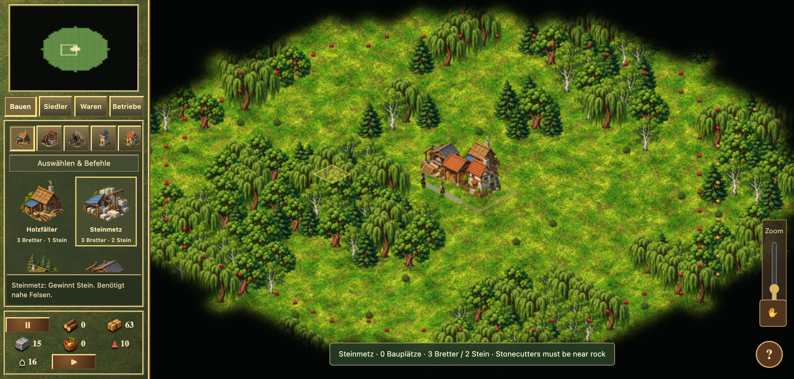
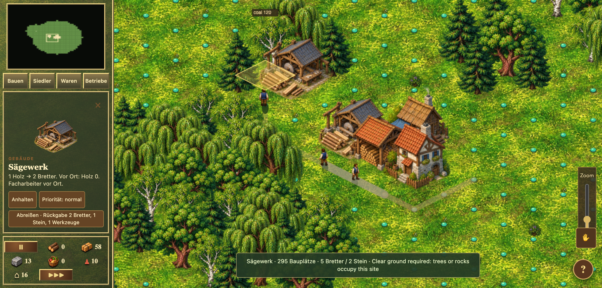
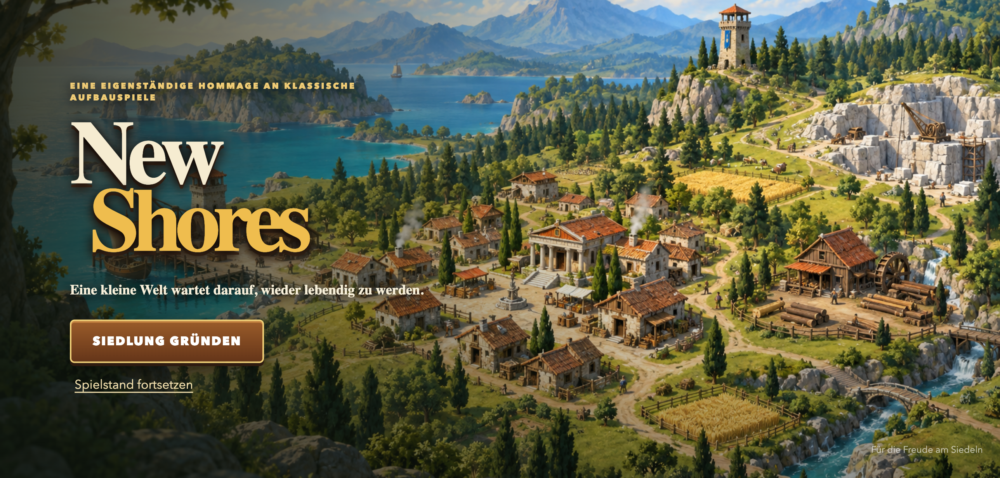

# New Shores

**Eine inoffizielle, von Die Siedler IV inspirierte Aufbau-Hommage für den Browser.**

Winzige Siedler, warme isometrische Landschaften, sichtbare Warentransporte und eine langsam wachsende Wirtschaft. Lokal auf dem Mac spielbar, mit Touch-Bedienung für mobile Browser.

> **Spielbarer Prototyp, kein fertiges Remake.** Dieses Projekt ist weder das originale *Die Siedler IV* noch ein offizielles Produkt von Ubisoft oder Blue Byte. Es gibt derzeit keine native macOS-App, keine iOS-App und keine App-Store-Version. Desktop-Browser wurden geprüft; die Unterstützung echter iPhones ist noch nicht vollständig verifiziert.

Aktueller Nachtrag: [Geologen, Bauphasen, Arbeitsdetails und Sound](AKTIVITAET_UPDATE.md). Das Repository ist inzwischen privat; die folgenden Bilder zeigen noch den vorherigen Stand.

## So sieht es tatsächlich aus

Die Bilder zeigen den laufenden Prototyp mit einer über die normalen Bauaktionen errichteten Siedlung. Keine Konzeptbilder und keine Screenshots des Originalspiels.

### Siedlung und Baumenü



### Waren und Transport


### Gebäude verwalten



<details>
<summary>Startbildschirm</summary>



</details>

## Auf dem Mac starten

Voraussetzungen: Git und **Node.js ab Version 22.12**.

```bash
git clone https://github.com/eliaspfeffer/new-shores.git
cd new-shores
npm ci
npm run dev
```

Öffne die im Terminal angezeigte lokale Adresse im Browser, normalerweise `http://localhost:5173`. Beende den Server mit `Ctrl+C`.

### Auf dem iPhone ausprobieren

1. Starte den Server auf deinem Mac wie oben beschrieben.
2. Verbinde Mac und iPhone mit demselben vertrauenswürdigen WLAN.
3. Öffne auf dem iPhone die vom Entwicklungsserver angezeigte **Network-Adresse**, beispielsweise `http://192.168.1.20:5173` – nicht `localhost`.
4. Verwende vorzugsweise das Querformat. Erlaube gegebenenfalls den Zugriff im lokalen Netzwerk auf dem Mac.

Der Mac muss dabei eingeschaltet bleiben und den Server ausführen. Das ist ein lokaler Browsertest, keine installierte iPhone-App und kein öffentlich gehosteter Spieldienst. Keine Portfreigabe am Router erforderlich. Echte iPhone-Geräte und Safari-Versionen sind noch nicht umfassend getestet.

## Was bereits funktioniert

- 24 baubare Gebäudetypen mit Bildvorschauen, Baukosten und Produktionsbeschreibungen, darunter zusätzliche Lager mit tatsächlichem Warentransport.
- Holz, Stein, Nahrung, Erz, Metall, Werkzeuge und Waffen als spielbare Produktionsketten.
- Materiallieferungen zu Baustellen, lokale Eingangsvorräte und direkte Transporte zwischen Betrieben.
- Sichtbare Waren an Trägern und Gebäuden; Facharbeiterzuweisung mit Werkzeugbedarf.
- Arbeitsgebiete für Holzfäller, Förster und Steinmetze; nachwachsender Wald.
- Automatisch entstehende Trägerwege, Territorien, Erkundung und Kriegsnebel; Brücke oder Fähre zur entdeckten KI-Insel.
- Pioniere, Geologen, Schwertkämpfer und Bogenschützen; einfache Kämpfe, Turmeroberung und drei Rekrutierungsränge.
- Auswahlgruppen, Gebäudestopp, Prioritäten und Abriss mit Rückgabevorschau.
- Automatisches Speichern, drei lokale Speicherplätze, JSON-Export/-Import und Sicherheitskopie.

**Spielstände liegen im jeweiligen Browser.** Sie werden nicht über GitHub oder zwischen Mac und iPhone synchronisiert. Exportiere wichtige Spielstände als Datei; Browserdaten zu löschen kann lokale Speicherstände entfernen.

## Bedienung

| Aktion | Mac / Touchpad | Touch |
|---|---|---|
| Karte bewegen | Mit zwei Fingern scrollen, Rechtsziehen oder Pfeiltasten | Mit einem Finger ziehen |
| Zoomen | Pinch oder Ctrl/Alt + Scrollen; Regler rechts | Regler rechts |
| Siedler auswählen | Anklicken oder Auswahlrahmen ziehen; Shift ergänzt | Antippen; zwei Finger bilden einen Auswahlrahmen |
| Ziel zuweisen | Freie Fläche anklicken oder Rechtsklick | Ziel antippen |
| Gebäude verwalten | Gebäude oder Eintrag unter „Betriebe“ anklicken | Antippen |
| Gruppe speichern / aufrufen | Ctrl/Cmd + 1–9 / entsprechende Ziffer | – |
| Pause | Leertaste oder Pausenschaltfläche | Pausenschaltfläche |

Beschäftigte Träger schließen eine Lieferung ab, bevor sie einen Marschauftrag ausführen. Werkstätten benötigen Personal und Werkzeuge; zwei Zivilisten bleiben für Logistik verfügbar. „Betriebe“ hilft beim Finden von Engpässen.

## Was noch fehlt

Unter anderem: vollständige Völker, Gelände/Höhen und Planierung, weitere Militärsysteme, Hochseeschiffe und Häfen, Echtzeithandel, Religion, Kampagnen, synchroner Mehrspieler sowie vollständige Arbeits-/Trage-/Kampfanimationen. Die vorhandene Gegner-KI und die kurze Fähre sind bewusst begrenzte spielbare Ausbaustufen. Kosten und Zeiten sind teilweise eigene Balancewerte.

Den genauen, ehrlichen Funktionsstand und die bisherigen Prüfungen findest du in [AUSBAU_AKTUELL.md](AUSBAU_AKTUELL.md). Ältere Audit-Dokumente sind als historische Stände gekennzeichnet.

## Entwicklung und Tests

Vanilla JavaScript, Canvas 2D und Vite. Kein Backend und kein Benutzerkonto nötig.

```bash
npm test
npm run build
npm run preview
```

Die neun Testsuiten prüfen unter anderem Produktion, Navigation, Direkttransport, Personal, Kampf, autonome Spezialisten, Außeneinsätze, Arbeitszustände, Baustufen, Erkundung, Abrissrückgaben und Spielstandvalidierung. Ein erfolgreicher Testlauf ist keine Garantie vollständiger Originaltreue oder Gerätekompatibilität.

Aktuelles Update: [Außeneinsätze, Feldwachstum und Ernte](AUSSENEINSAETZE.md), einschließlich verbleibender Lücken und Prüfungen. Davor: [Autonomie, eigene Baustufen und Arbeitsplatzwege](AUTONOMIE_BAUPHASEN.md).

## Grafik und Projektstatus

Die Grafiken wurden für diese Hommage generiert und im Projekt eingebunden. Original-Screenshots dienten als Referenzen; Originalspiel-Dateien sind nicht enthalten. Herkunft und Arbeitsweise: [Grafikreferenzen](GRAPHICS_REFERENCE.md), [Art-Prompts](assets/ART_PROMPTS.md), [Warengrafik-Prompts](assets/GOODS_PROMPTS.md).

*Die Siedler / The Settlers* wird ausschließlich zur Benennung der Inspiration erwähnt. New Shores ist ein eigenständiger, inoffizieller Prototyp ohne Zugehörigkeit zu den Originalherstellern.

**Lizenz:** Eine Projektlizenz wurde noch nicht festgelegt.
