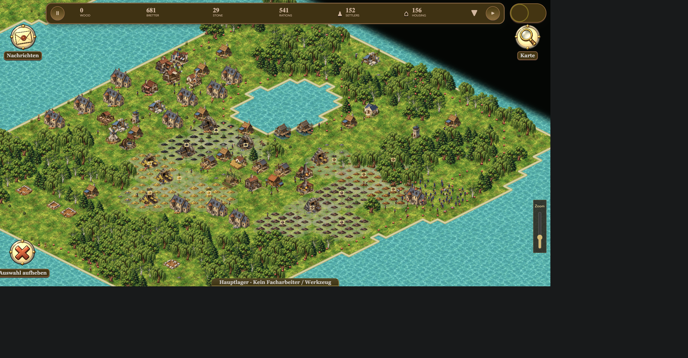
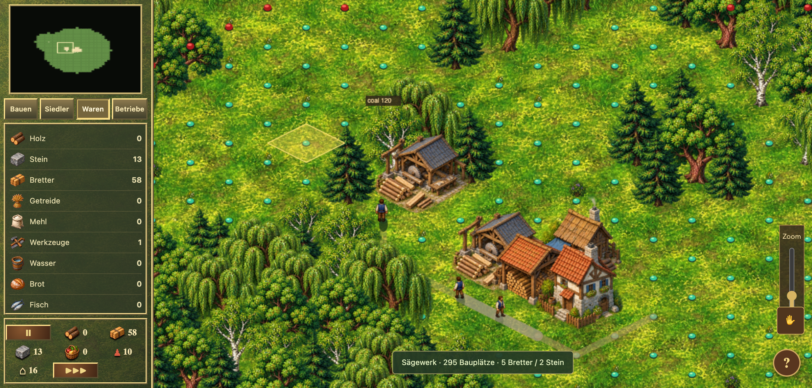

# New Shores

An open-source, real-time strategy and settlement-building game inspired by **Age of Empires** and **The Settlers IV**. Build an island settlement, connect production chains, transport goods, explore, and raise an army — all in your browser.

**[Play now → settler.eliaspfeffer.de](https://settler.eliaspfeffer.de)**

## Run locally

Install [Node.js 22.12+](https://nodejs.org/) and Git, then:

```sh
git clone https://github.com/eliaspfeffer/new-shores.git
cd new-shores
npm ci
npm run dev
```

Open **http://localhost:5173** (or the URL printed in your terminal). Choose **Singleplayer → Skip → Found settlement**. Local single-player needs no account or database. Saves stay in your browser; export important saves before clearing browser data.

## Screenshots

A developed island settlement in the live game:



Production and goods transport (earlier interface):



## Development

Vanilla JavaScript, Canvas 2D, and Vite.

```sh
npm test
npm run build
```

For accounts, cloud saves, and multiplayer, see [server setup](SERVER_BETRIEB.md).

[MIT licensed](LICENSE). An independent work in progress, unaffiliated with the creators of Age of Empires or The Settlers. Artwork was generated for this project; see [graphics references](GRAPHICS_REFERENCE.md).
